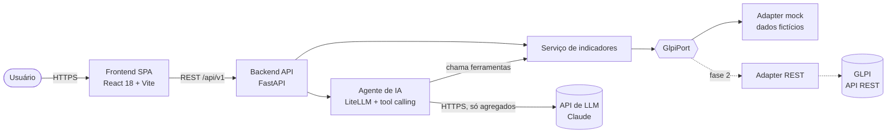

# 02 — Arquitetura

Fonte oficial dos diagramas: [diagramas/](diagramas/) (C4-PlantUML). As
visões Mermaid abaixo são apenas para leitura rápida no GitHub.

## Visão de contêineres



## Componentes

| Componente | Responsabilidade | Tecnologia |
|---|---|---|
| **Frontend** | Painéis, filtros, chat; renderiza visualizações devolvidas pela IA | React 18, Vite, TypeScript, Recharts |
| **API** | Endpoints REST versionados, validação, orquestração | FastAPI, Pydantic v2, Python 3.12 |
| **Serviço de indicadores** | Implementa as fórmulas de [01-indicadores.md](01-indicadores.md) sobre uma lista normalizada de chamados | Python puro (testável sem I/O) |
| **GlpiPort** | Interface que entrega chamados normalizados; isola o domínio do GLPI | Protocol Python |
| **Adapter mock** | Gera/carrega dados fictícios determinísticos (seed fixa) | JSON em `backend/data/mock/` |
| **Adapter REST** (fase 2) | Sessão na API REST do GLPI com App-Token + User-Token, paginação, mapeamento de campos | httpx (async) |
| **Agente de IA** | Recebe a pergunta, escolhe ferramentas, monta resposta em texto + especificação de visualização + filtros sugeridos | LiteLLM, modelo padrão Claude |
| **Cache** | Evita recalcular indicadores com o mesmo filtro | Memória no MVP; Redis depois |

## Fluxo principal: pergunta em linguagem natural

Ver [diagramas/02-fluxo-critico-pergunta-ia.puml](diagramas/02-fluxo-critico-pergunta-ia.puml).

1. Front envia `POST /api/v1/chat` com a pergunta, o histórico curto e os filtros ativos do painel.
2. Agente chama o LLM com o *system prompt* versionado e a lista de ferramentas.
3. O LLM pede uma ou mais ferramentas (ex.: `consultar_sla(tipo_sla="ttr", grupo_tecnico="N2 - Suporte Técnico", periodo_inicio=..., periodo_fim=...)`).
4. O backend executa a ferramenta no serviço de indicadores e devolve ao LLM **somente o resultado agregado**.
5. O LLM entrega a resposta chamando a ferramenta `responder_usuario` (texto, número da chamada a ilustrar e filtros sugeridos). O backend valida os argumentos e **monta o gráfico a partir do resultado real da ferramenta** — o modelo nunca escreve os números do gráfico. Resposta da API:

```json
{
  "resposta": "Em setembro o N2 cumpriu 87,4% do SLA de solução (153 de 175 chamados).",
  "visualizacao": { "tipo": "kpi", "titulo": "SLA de solução do N2 — set/2026", "kpis": [{ "rotulo": "Cumprido", "valor": 87.4, "unidade": "%" }] },
  "filtros_sugeridos": { "grupo_tecnico": "N2", "periodo_inicio": "2026-09-01", "periodo_fim": "2026-09-30" },
  "rastreio": [{ "chamada": 1, "ferramenta": "consultar_sla", "argumentos": {} }],
  "trace_id": "...",
  "modelo": "anthropic/claude-opus-5-5"
}
```

6. Front exibe a resposta e o gráfico; se o usuário aceitar, aplica `filtros_sugeridos` ao painel.

## Ferramentas expostas ao LLM (MVP)

| Ferramenta | Indicador | Retorno |
|---|---|---|
| `consultar_volume` | IND-01 | série temporal de abertos/solucionados/fechados |
| `consultar_backlog` | IND-02 | contagem por faixa de aging (e grupo) |
| `consultar_sla` | IND-03, IND-04 | % cumprido, cumpridos, elegíveis, por dimensão opcional |
| `listar_sla_em_risco` | IND-05 | contagens e IDs (sem título/descrição) |
| `consultar_tempos` | IND-06 | média, mediana, p90 em horas |
| `consultar_distribuicao` | IND-07 | top N por dimensão |
| `listar_valores_filtro` | — | nomes válidos de grupos, categorias, entidades |

Todas são **somente leitura** e têm parâmetros validados por Pydantic. O LLM
não gera SQL nem consultas livres ([ADR-0003](adr/ADR-0003-ia-tool-calling-somente-leitura.md)).

**Detalhes de implementação (SPEC-2026-0005):**
- `tool_choice` é sempre `auto`: os modelos Claude atuais recusam escolha forçada de ferramenta, por isso a
  resposta final vem da ferramenta `responder_usuario` em vez de `response_format`.
- Saída inválida (sem `responder_usuario`, argumentos fora do schema, número sem nenhuma ferramenta de dados,
  `responder_usuario` junto com outras ferramentas) recebe uma correção; na segunda falha a API retorna 502.
- Timeout/5xx do modelo principal troca para `LLM_FALLBACK_MODEL` até o fim da pergunta; sem modelo
  disponível, 503. Chave ausente ou inválida também retorna 503, com mensagem de configuração.
- Cada pergunta gera um log JSON `chat` com `trace_id`, modelo, tokens de entrada/saída, ferramentas e duração.

## Estrutura de pastas planejada

```
backend/
  app/
    api/v1/          # routers: indicadores, chat, health
    domain/          # modelos normalizados (Ticket, Filtro) e serviço de indicadores
    adapters/glpi/   # port + mock + rest
    ai/              # agente, ferramentas, prompts/ (YAML versionado)
  data/mock/
  tests/
frontend/
  src/
    components/      # cards, gráficos, tabela, chat
    api/             # cliente da API
    pages/
docs/  specs/  agent_docs/
```

Monorepo no MVP; separar em repositórios por componente ao entrar na esteira
da TI ([ADR-0005](adr/ADR-0005-monorepo-no-mvp.md)).

## Requisitos não funcionais do MVP

| Atributo | Meta |
|---|---|
| Latência dos indicadores | p95 < 500 ms com o dataset mock (~5 mil chamados) |
| Latência do chat | p95 < 10 s por pergunta |
| Custo de IA | Registrar tokens de entrada/saída por pergunta (log estruturado) |
| Segurança | Chaves só por variável de ambiente; `.env` fora do Git |
| Observabilidade | Logs JSON com `trace_id`; OpenTelemetry + OpenLIT na fase de esteira |
| Testabilidade | Serviço de indicadores com cobertura ≥ 85% |
